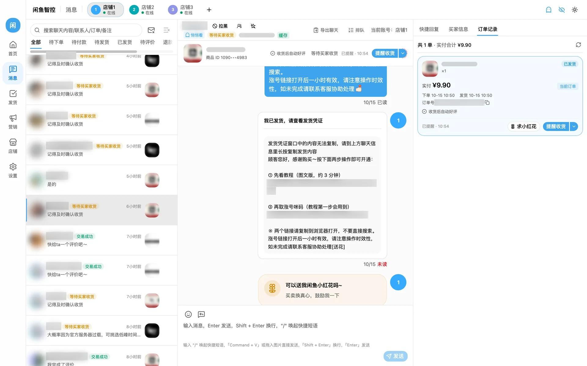
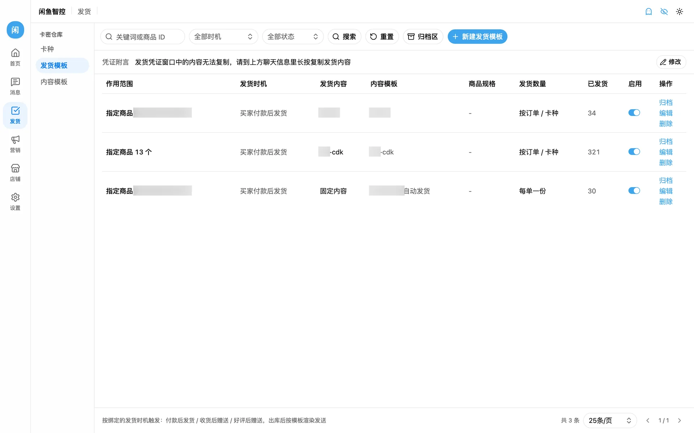
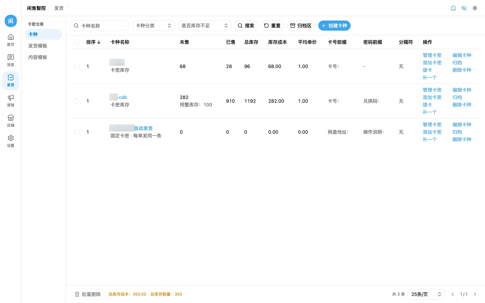
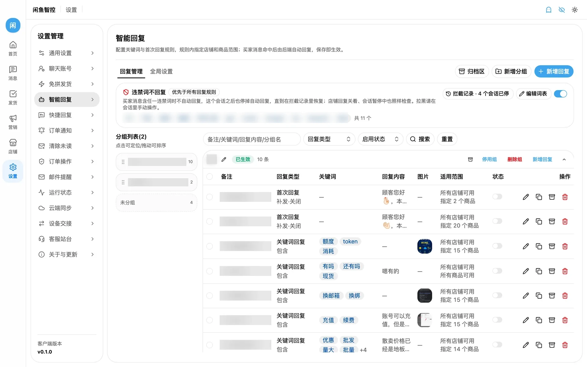
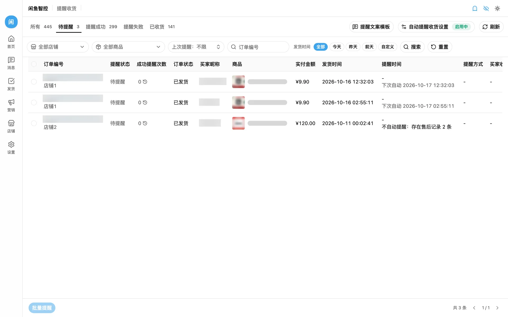
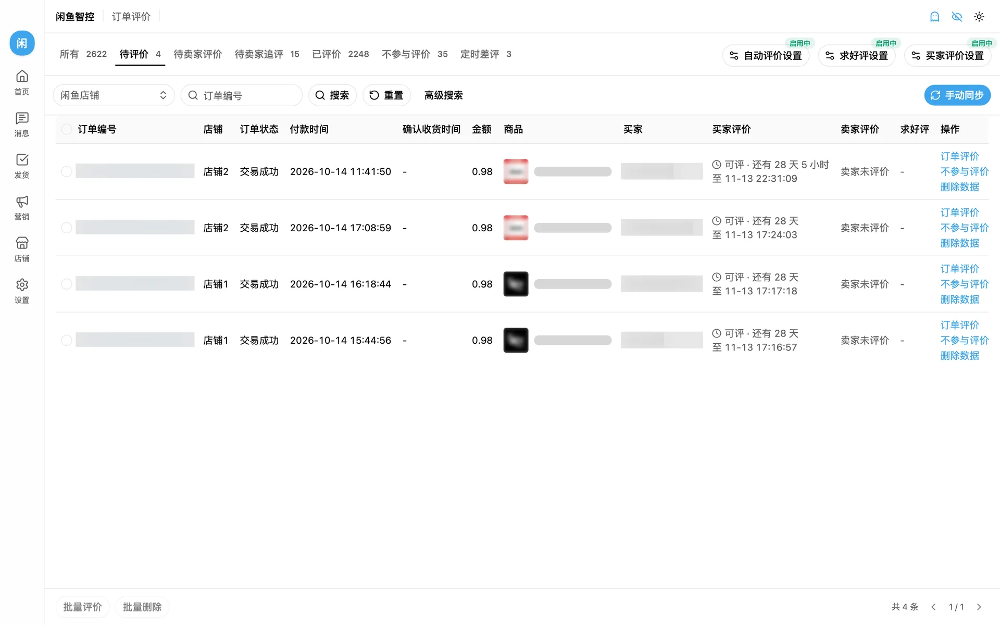
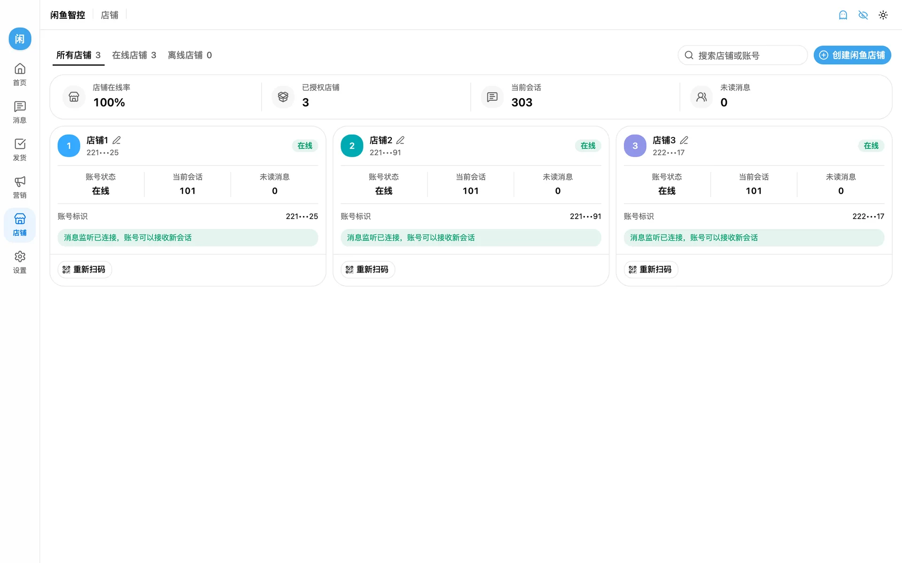
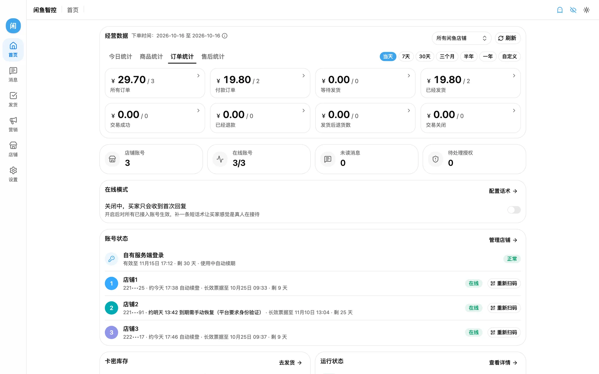

  
  <h1>闲鱼智控</h1>
  
<b>闲鱼卖家的电脑客户端 · 一个入口，管好多个店铺</b>

  
付款自动发货 · 买家来问自动回复 · 到点提醒收货 · 收货自动好评

  

    <a href="https://xianyu.dongeai.com/">产品官网</a> ·
    <a href="https://github.com/dev-longshun/xianyu-zhikong/releases/latest">下载客户端</a> ·
    <a href="#购买与联系">购买与联系</a> ·
    <a href="docs/INSTALL.md">安装指南</a> ·
    <a href="https://xianyu.dongeai.com/tutorials/">使用教程</a> ·
    <a href="https://xianyu.dongeai.com/changelog/">更新日志</a> ·
    <a href="https://github.com/dev-longshun/xianyu-zhikong/issues">反馈问题</a>
  

  
<b>Mac / Windows · 19 元起 / 月 · 一份授权两台电脑</b>

> 本仓库用于闲鱼智控的产品介绍、客户端下载与问题反馈，不提供产品源码。闲鱼智控是第三方卖家工具，与闲鱼官方无关，也不是官方的「闲管家」。

## 每天重复做的事，交给它

多个店铺来回切、付款后手动发卡、重复回答相同问题、催收货、回评价……闲鱼智控把这些工作放进同一个电脑客户端，让你集中处理需要亲自处理的事。

| 日常工作 | 闲鱼智控怎么帮你 |
| --- | --- |
| 多个店铺的消息来回切 | 同一客户端登录多个店铺，顶栏切换；聊天旁边就是买家的订单 |
| 买家付款后手动发货 | 按模板自动发送卡密、链接或文字，支持固定卡密与自有发卡接口 |
| 同一个问题反复回答 | 关键词匹配自动回复，图文一起发；规则按组管理 |
| 发完货还要记着催收货 | 到点按模板自动提醒，有售后或纠纷的订单跳过 |
| 收货后逐单回评价 | 自动好评，支持排除买家；发货后就能求小红花 |
| 对账、看哪些商品卖得好 | 查看支付、退款、实际收入，点开逐笔明细并导出 |

适合同时经营多个闲鱼店铺，以及经常需要交付卡密、链接、文字内容的卖家。

## 下载客户端

**当前安装版：v1.5.0（2026-11-08 发布）。** 可以先下载安装、打开查看界面；登录闲鱼店铺前需要激活码。

| 系统 | GitHub 下载 | 备用下载 |
| --- | --- | --- |
| Mac · Apple 芯片 · macOS 11 及以上 | [下载 DMG](https://github.com/dev-longshun/xianyu-zhikong/releases/download/v1.5.0/xianyu-zhikong-1.5.0-mac-arm64.dmg) | [官网下载](https://dl.longjinapi.com/xianyu-zhikong-mac-arm64.dmg) |
| Windows · 64 位 Windows 10 / 11 | [下载安装 EXE](https://github.com/dev-longshun/xianyu-zhikong/releases/download/v1.5.0/xianyu-zhikong-1.5.0-windows-x64.exe) | [官网下载](https://dl.longjinapi.com/xianyu-zhikong-windows-x64.exe) |

Mac 暂不支持 Intel 芯片。手机不能安装，请在电脑上下载。

安装步骤见 [安装指南](docs/INSTALL.md)，历史版本与文件校验见 [Releases](https://github.com/dev-longshun/xianyu-zhikong/releases)。

## 功能介绍

### 多店铺消息与客服

- 一个客户端登录多个闲鱼店铺，顶栏一点切换，每个店铺有自己的消息页。
- 会话列表、聊天内容、买家订单放在同一页；改价、发货、提醒收货、求小红花都在订单旁操作。
- 按昵称、订单号、聊天文字搜索会话，支持会话标记和筛选。
- 「悄悄看」打开会话不显示已读；双击「消息」跳到下一个未读。
- 常用话术和表情一点发送，支持拖图、粘贴发图和长截图。

### 自动发货与卡密仓库

- 买家付款后，按模板自动发送卡密、链接或文字。
- 固定卡密导入卡种按单发出，也能接自己的发卡接口，每单实时取卡。
- 卡种、库存和已发数量一页看清；库存不足弹窗提醒。
- 补货后可以一键补发，漏发订单也能手动补发。
- 两人小刀尚未拼成的订单，可在会话里一键免拼。

展开查看卡密仓库

### 关键词自动回复

- 按关键词匹配回复，文字和图片可以一起发。
- 规则分组管理，暂停一个组就能整组停用。
- 支持「违禁词不回复」：命中后停止该会话的自动回复，避免继续误答。
- 买家的语音可自动转成文字，转写内容也能匹配回复规则。

### 提醒收货、自动评价与求小红花

- 发货后到设定时间，按你的文案自动提醒买家确认收货。
- 有售后、有纠纷的订单不自动提醒，列表直接显示原因。
- 买家确认收货后自动好评；拉黑、有售后的订单不评，也可单独设置买家不自动评价。
- 发货后就能求小红花，无需等到确认收货。

展开查看评价管理

### 在线状态与异常提醒

- 登录到期前自动续登；遇到可通过「快速进入」恢复的情况，客户端尝试自动恢复。
- 需要刷脸、短信或自动恢复失败时，仍需人工处理。
- 掉线、买家等待 3 分钟无人回复时，可通过配置的邮件提醒你。
- 重连后提示离线期间付款的订单，方便核对处理。
- Mac 支持「挂机不休眠」设置，方便持续运行。

### 经营数据与对账

- 查看支付、退款、实际收入等数据，按对应口径剔除退款单和 0 元单。
- 数据卡片可点开逐笔明细，并支持导出对账。
- 按商品查看销售表现。
- 支持今天、近 7 天、近 30 天与自定义时段。

### 还有这些顺手的细节

- **截图隐私模式**：店名、头像、商品一键打码。
- **导出聊天**：保留完整聊天，方便自己复盘或分析纠纷。
- **语音转文字**：买家发语音，也能直接看文字内容。
- **按时段静音**：下班后提示音按设置静音。
- **自动擦亮**：按闲鱼服务器时间执行每日擦亮。
- **设备交接**：更换电脑时，可使用设备交接功能迁移数据。

本页截图均来自实际客户端，买家、商品与店铺信息已打码。展示的是商业安装版能力，云端同步、客服站台不包含在商业安装版内。

## 作者自己的店，每天都在用

以下为作者自己几个店铺中，截至 **2026 年 10 月 28 日**的累计执行记录，沿用官网当日统计；不是用户数或销量承诺。

| 自动化工作 | 累计记录 |
| --- | ---: |
| 自动发货 | 2,229 单 |
| 自动提醒收货 | 2,057 单 |
| 自动好评 | 1,985 单 |
| 自动求小红花 | 2,194 单 |
| 自动回复 | 2,519 条 |

## 购买与联系

两个版本功能完全一样，都是一份授权激活两台电脑，Mac（Apple 芯片）和 Windows 均可使用，上述商业安装版功能包含在内：

- **基础版 19 元 / 月**：每台电脑登录 1 个闲鱼账号，两台电脑一共 2 个；换账号先退出当前账号，再扫码登录。
- **高级版 29 元 / 月**：每台电脑登录的闲鱼账号数量不限。

此前购买的激活码均按高级版使用。基础版激活码需要 1.4.0 及以上版本。两个版本的逐项对比见官网[价格页](https://xianyu.dongeai.com/pricing/)。

可以先下载查看界面，确定适合后再加作者微信购买激活码。

**作者微信：`OxRabbitno1`**（首字母为大写字母 O）

[查看产品官网](https://xianyu.dongeai.com/) · [查看安装指南](docs/INSTALL.md)

## 常见问题

**这是开源项目吗？** 不是。本仓库只展示产品和提供安装包，不提供产品源码；下载不代表获得免费授权。

**没买能先看看吗？** 能。下载安装后可以打开查看界面；登录闲鱼店铺前需要购买激活码。

**电脑要一直开着吗？** 要。自动发货、自动回复等任务在电脑上运行，客户端需要保持运行并联网。

**能同时管几个店铺？** 一份授权两台电脑，每台电脑能登录 5 个以上店铺；实际运行情况会受到电脑配置、网络及平台状态影响。

**卡密从哪里来？** 自行导入固定卡密，或者接入自己的发卡接口。软件本身不提供货源。

**能保证永不掉线吗？** 平台状态和网络会影响连接。客户端提供续登、恢复与提醒机制，需要人工验证时仍要手动处理。

**和闲鱼官方有关系吗？** 没有。闲鱼智控是第三方卖家工具，不是闲鱼官方产品。

## 问题反馈

使用问题、功能建议可以在 [Issues](https://github.com/dev-longshun/xianyu-zhikong/issues) 提交；激活码、付款与账号相关问题请直接联系作者。

反馈时请说明客户端版本、操作系统、复现步骤，并附打码截图。请勿公开 Cookie、密码、激活码、订单隐私或买家个人信息。
